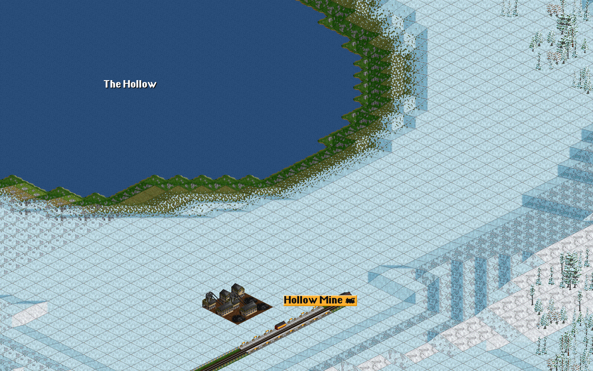
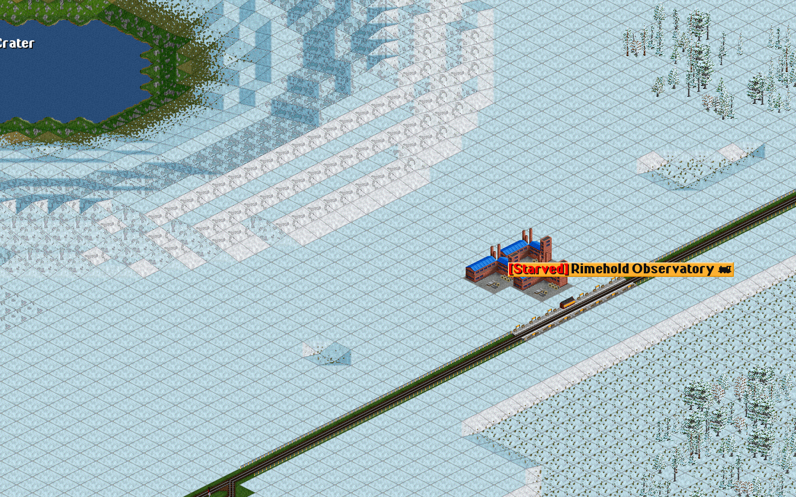
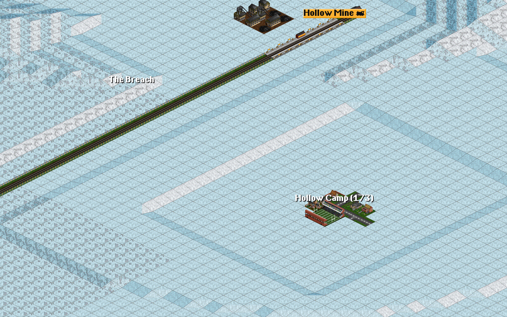
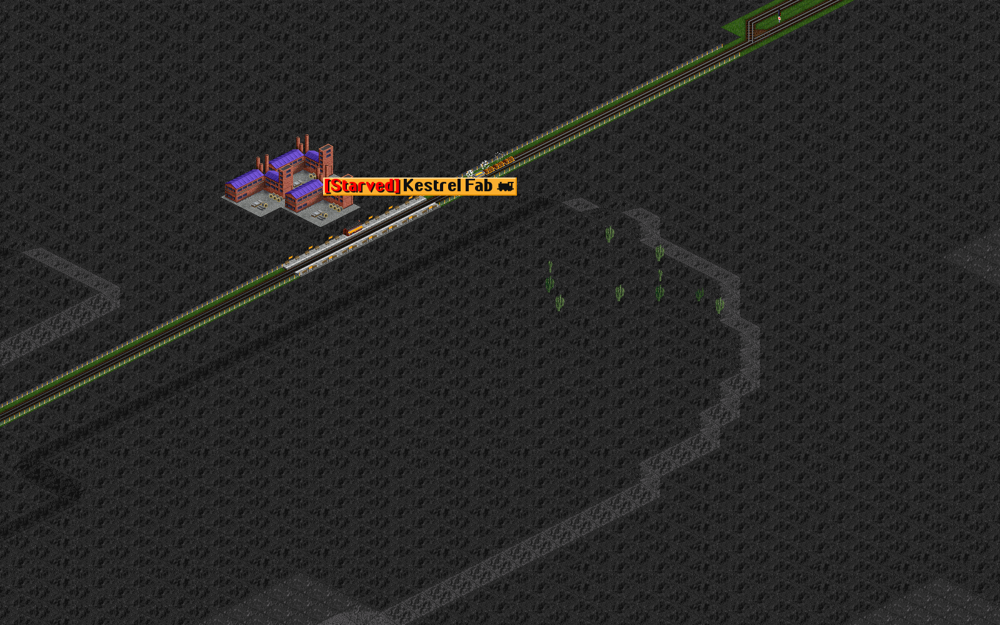
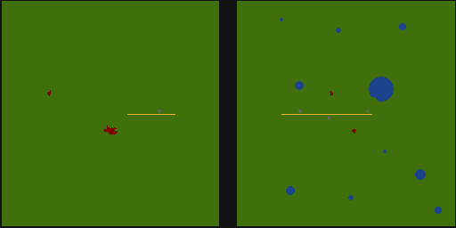

# The Hollowfrost Survey — automated proof, 23 October 2026

**Human UAT: Pending.** Headless authoring, service and reload proof only; these
images are agent-rendered review captures, not acceptance.
[Design](../../../ALIEN_FRONTIERS.md) · [play guide](../../../../demo/alien_worlds/PLAY.md) ·
[evidence](evidence.json).

## What ran

1. `alien_worlds.py prepare --publish demo/alien_worlds/Hollowfrost-Survey.sav`:
   a fresh 512×256 dedicated game, held paused from generation, authored by
   `alienworld prepare hollowfrost`. The mission script briefed the company while
   paused. Checks passed: zero invalid slopes, 1,037 still-water lake tiles, 58,524
   snow, 43,074 basalt and 31,540 rock tiles, 2,851 grove tiles, mission cargo text
   in `en_US`, four charter works with empty stores, five empty platforms, one idle
   survey train, one public gate pair, £2,000,000 and the three open goals. A
   cold reload in a new process was identical.
2. `alien_worlds.py prove` on a copy of the published opening: the reference rail
   (£13,905) and the six-order survey train, then the real server loop at full
   speed. Goals were first seen complete at game days 310, 231 and 601 (a second run:
   328, 255 and 619; polling is about a month coarse). 60 quantum crystals were
   stored, the contract offer and completion pages appeared, the £250,000 standard bonus was paid, and
   the train never crashed or lost its path. The completed save cold-reloaded identically.
3. `alien_worlds.py shots` on the completed save, SDL offscreen: the minimap and
   the views below.

The opening is reproducible except for two per-game random identities, the
savegame ID in `DATE` and the federation namespace in `FIDS`; a byte comparison
of two preparations differed only there.

| View | |
|---|---|
| The Hollow and its meltwater lake |  |
| Rimehold Crater above the observatory |  |
| The Breach, Hollow Mine and the survey train |  |
| Kestrel Fab on the basalt of Kestrel Forge |  |
| Minimap (OpenTTD draws it mirrored east–west) |  |

The generation contract still passes for seeds 11, 101 and 2026 after
`MultiWorldGen::BuildPublicGatePair` was factored out of world generation.
